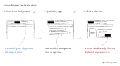

# autochrome

An MCP server that lets Claude Code drive the browser you already use on a Mac: list and open tabs, read a page, click, type and attach a local file. It talks to the browser through AppleScript (JXA), so there is no extension to install, no browser restart and no open port. Your logged-in sites, such as WhatsApp Web, work as they are.

Vivaldi comes first and is the one tested. Other Chromium browsers with AppleScript (Google Chrome, Brave, Microsoft Edge, Arc) use the same calls.



> **Em português:** servidor MCP para o Claude Code mexer no navegador do Mac, a começar pelo Vivaldi: listar e abrir abas, ler a página, clicar, digitar e anexar arquivo. Usa AppleScript (JXA), sem extensão, sem reiniciar o navegador e sem porta aberta. Os sites já logados, como o WhatsApp Web, funcionam do jeito que estão. Nada é enviado sozinho: mandar é um clique que o agente precisa escolher.

## Install

```bash
git clone https://github.com/LimaJoota/autochrome
claude mcp add --scope user autochrome -- /usr/bin/python3 "$PWD/autochrome/autochrome.py"
```

Then, in the browser, turn on **Allow JavaScript from Apple Events** (Vivaldi: Settings, Privacy, Apple Events; Chrome: View, Developer). The first call makes macOS ask for the Automation permission for the app that runs Claude Code.

## What it needs

- macOS and a Chromium browser with AppleScript. Default: Vivaldi. Pick another with the `browser` argument or `AUTOCHROME_BROWSER`, using the app name (`Google Chrome`, `Brave Browser`, `Microsoft Edge`, `Arc`).
- Python 3.9 or newer. No packages.

## Tools

| Tool | What it does |
| --- | --- |
| `tabs` | Lists tabs: id, title, URL. `*` marks the active one. |
| `open` | Opens a URL in a new tab and returns its id. Leaves your tab in front unless `activate`. |
| `read` | Title, URL, visible text and numbered elements you can click or type into. File inputs show up even when hidden. |
| `click` | Clicks by number from `read` or by CSS selector. |
| `type` | Types into an input, textarea or editable field. `clear` and `enter` are optional. |
| `attach` | Puts a local file into a file input, or drops it on a drop area. |
| `js` | Runs JavaScript in the tab (function body, use `return`). |
| `close` | Closes a tab by id. |

Every tool takes `browser`. Without MCP: `python3 autochrome.py call read '{"tab_id":"123"}'`.

## Safety

- While **Allow JavaScript from Apple Events** is on, any program on this Mac with the Automation permission for the browser can run JavaScript in your tabs, logged-in sites included. Turn it off when you do not need it.
- `read` brings the page text into the conversation, private messages included. Point it at the tab you mean.
- Nothing sends by itself. Sending a message is a separate click on the send button.
- `close` closes whatever tab id you give it. Tab ids come from `tabs` or `open`.
- A call to a browser that is not running opens it.

## Limits

- The script runs in its own JavaScript world: it sees the page's DOM, not the page's variables.
- Clicks and keys are synthetic events. Most sites accept them; a page that checks `isTrusted` will not react. The native file dialog never opens; `attach` sets the file directly.
- A hibernated tab does not answer. Open it first.
- Safari and Firefox are not supported yet: Safari has a different AppleScript dictionary, Firefox has none.

## Test

```bash
python3 teste/teste.py
```

Opens a local page in a background tab, clicks, types, attaches a 1.2 MB file, checks it byte for byte and closes the tab.

## Status

Tested end to end on Vivaldi 8.3 on macOS with the local test page. Chrome, Brave, Edge and Arc not run yet. Not yet run on WhatsApp Web.

Not affiliated with Google or Vivaldi Technologies. Chrome and Vivaldi are their trademarks.

## License

MIT
